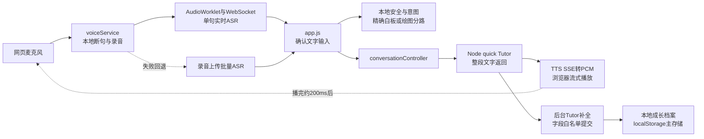
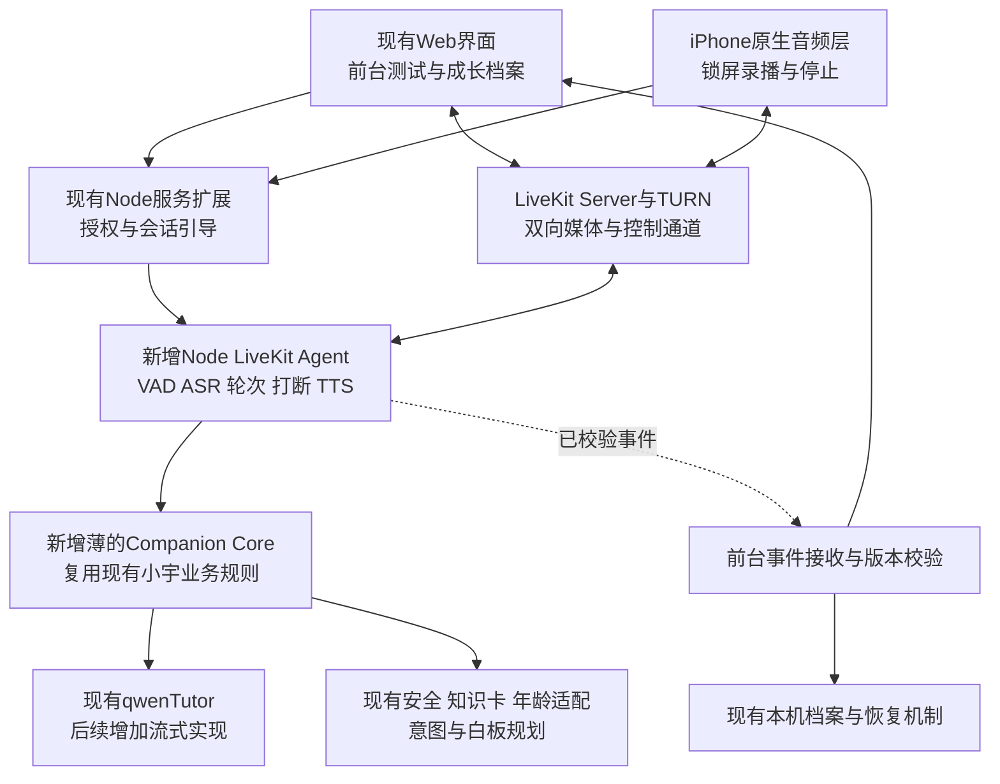

# 基于现有小宇记架构接入 LiveKit：审查与迁移设计

2026-11-01进展：独立本机LiveKit实验已新增，详见[实施记录](changes/2026-11-01-livekit-loop.md)。下文为10月27日迁移设计；其中“所有新增未实施”是当时状态。当前已有Agent/网页/适配代码，真实Qwen接口和合成输入的本机WebRTC闭环已验证；识别开头丢失、延迟和稳定性仍未达标，正式页面和iPhone桥接仍未验收。详见[真实联调记录](changes/2026-11-01-livekit-real-validation.md)。

日期：2026-10-27。审查基点：仓库 HEAD `0ba6781`，当前 App 在 `product/`。

状态：初轮完成源码审查和48项现有模拟测试。随后已实施有限HTTP上下文、业务计算无档案直写、Qwen取消语义三项基础修正，完整回归305项及8条浏览器流程通过，见 [整体架构审查与实施记录](architecture-review-2026-10-27.md)。本文所有LiveKit新组件、接口和原生桥接仍为拟议设计，尚未实现、安装、部署或付费调用。表内行号为初次审查时的定位，后续修改会使其偏移。

## 1. 建议结论与对上一版计划的纠正

在现有 JavaScript/Node 产品旁增加一个 **Node.js LiveKit Agent 进程**。LiveKit 管连续音频、话轮和可中断播放；小宇现有业务模块管回应原则、安全、知识卡、白板与成长证据。不要把现有产品变成另一个只有普通提示词的语音机器人。

首个增量目标是“同样的小宇逻辑、同样的模型基线，通过 LiveKit 连续听说并正确打断”，之后才分别优化文字流式、TTS自然度和附和识别。这样可以判断改进来自传输/调度还是模型更换。

| 上一版通用假设 | 本次源码核查后的设计 |
|---|---|
| 4–8岁 | 产品服务0–6岁家庭，首先验证3–6岁直接语音；0–3岁家长辅助 |
| 默认Python Agent | 优先Node.js Agent，复用现有ES模块；只有关键SDK/性能缺口被证实才考虑Python媒体服务 |
| ASR需要从零建设 | 已有实时上传ASR和批量回退；缺连续会话与说话时听入 |
| 一开始全换ASR/LLM/TTS | 先保持配置基线，完成旧链路/LiveKit对照；再单独替换供应商 |
| 默认10分钟/20分钟时限 | 现有产品不设陪伴倒计时；保留主动停止、家长权限与费用熔断。可选家长时限需另作产品决定，不自动启用 |
| 三人全职八周 | 已有团队资料仍未承诺工时；按任务门槛和人日估算，不将八周视作排期承诺 |

用户已确认中国大陆家庭、iPhone优先。原生锁屏实验作为隔离验证支线，尚不等于正式替换当前Web产品；不以此跳过现有网页/家庭验证。

依据：[产品框架](product-framework.md)、[会话管理源码](../src/session/sessionManager.js)、[团队接手基线](team/baseline-2026-10-25.md)、[开发日记](development-log.md)。

## 2. 当前真实架构：已有的不是零

| 已核实事实 | 代码证据（审查时行号） | 对设计的影响 |
|---|---|---|
| 当前入口是原生JS页面与Node HTTP服务；未依赖LiveKit | `product/package.json`；`server/server.mjs:1` | 独立增加语音worker，不迁移根目录旧vinext模板 |
| ASR音频在结束前已通过WebSocket发送；客户端finish后只接一次final | `src/services/realtimeAsr.js:1`；`server/realtimeAsr.mjs:18,55,68,95` | 这是单句流式输入，不是全会话双工；保留协议经验，改成SDK流适配 |
| ASR关闭服务端turn_detection，忽略partial和情绪推断 | `server/realtimeAsr.mjs:55,79` | 新链路保留不把猜测写入证据的规则；轮次裁决只由Agent负责 |
| 普通输入开始时停止播报、停止收音 | `src/app.js:608–616` | 不能只用LiveKit替换WebSocket而保留这个互斥流程 |
| 自动续听跳过thinking/speaking和隐藏页面 | `src/app.js:926–936,1704` | 双工模式退出这套循环；旧模式继续保留 |
| quick和complete两个文字调用均为stream:false | `server/qwenTutor.mjs:164,238` | 当前“quick”是短回答，仍不是token流式 |
| TTS完整text输入，SSE音频输出，再转PCM | `server/speechStream.mjs:41–63` | 可作第一阶段TTS基线，不应称为双向文本流式 |
| 对话已具备turnId、AbortController、目标消息和session检查 | `src/features/conversation/conversationController.js:23–70` | 保留这些语义；迁移时升级为跨媒体事件ID，不另起无保护的状态系统 |
| commit只允许quick/complete/protected，校验目标快照、会话与状态 | `src/features/conversation/conversationCommit.js:8–65` | 不能把网络事件直接塞给现有commit；需要窄的实时事件归约器 |
| 保存完整回答发生在speak调用之前 | `src/app.js:766–781`；`saveGrowthMoment:817` | 双工模式必须增加生成/已播/打断的区分 |
| Student DB使用window.localStorage；IndexedDB是备用快照 | `src/data/localStudentDb.js:16–34`；`src/services/indexedArchive.js` | Node Agent不能直接写它；Supabase草案不等于已有云数据库 |
| 原有HTTP防护是同源与请求校验 | `server/server.mjs:59`；`tests/server-boundary.test.mjs` | 不能当作用户身份认证；原生客户端需要单独授权合同 |

配置核查只读取`.env.example`和源码默认值，未读取真实密钥或探测线上配置。示例中的qwen3.7-flash、qwen3-asr-flash-realtime、qwen-audio-3.0-tts-flash只作为当前候选基线记录，不宣称已在本环境开通或质量达标。

文档漂移：旧`architecture.md`中的“ASR仍为录完上传”和`realtime-voice-plan.md`的历史计划没有跟上实时ASR代码。本次仅补正当前说明，历史日期段落保留为历史。

## 3. 目标架构：新增语音运行层，复用业务层

图中所有“新增”均未实施。媒体音频通过WebRTC传输，普通API不再转发每一帧；业务函数尽量在Agent进程内直接调用，避免为三个人的小团队拆成多层HTTP微服务。Node HTTP进程和Agent进程可以共享模块，不能共享内存对象或依赖同一个模块全局变量同步状态。

一台境内测试服务器可同时承载HTTP、Agent与LiveKit/TURN的初始实验，但分别管理进程与资源。没有必要先加Kubernetes、消息队列、向量库。4070继续用于离线/本地模型对照，不成为主链路上线前置条件。

## 4. 为什么改为优先Node.js Agent

LiveKit官方提供Node Agents、模型管线、数据通信和节点钩子；当前仓库的安全、意图、年龄、知识、白板与Tutor全部是可被Node导入的JS模块。[Node官方文档](https://docs.livekit.io/reference/agents-js/)、[AgentHooks](https://docs.livekit.io/reference/agents-js/interfaces/agents.voice.AgentHooks.html)

用Python也可以，但现在必须选择“移植规则”或“增加Node业务服务请求”，都会增加边界。先给Node一个2人日可行性门槛：Agent启动、中文ASR适配、LLM钩子、TTS音频输出、取消传播。若选定SDK在必要能力上失败且没有简单解法，再改Python媒体Agent＋Node业务接口；不要为偏好迁移语言。

官方当前可用`voice.Agent.create`、`onUserTurnCompleted`、`llmNode`、`ttsNode`，音频轮次检测有`inference.TurnDetector({version:'v1-mini'})`本地CPU路径。Node参数使用毫秒，与Python秒值不同。D1锁定实际版本，本文不提供未经安装验证的“可直接运行”启动代码。[节点说明](https://docs.livekit.io/agents/logic/nodes/)、[轮次检测](https://docs.livekit.io/agents/logic/turns/turn-detector/)

自适应附和判断依赖Cloud服务的情况仍需单独核实和开关控制；中国大陆儿童试用不能默认增加境外音频路径。先mini＋VAD，云adaptive只对成人/合成样本比较；规则回退不宣称效果等价。[官方自适应打断](https://docs.livekit.io/agents/logic/turns/adaptive-interruption-handling/)

## 5. 具体文件边界与最小改动

以下新增路径均是建议，不是已创建的运行代码。第一阶段只建立实际需要的文件，不预建空框架。

| 文件/目录 | 决策 | 具体责任 |
|---|---|---|
| `server/server.mjs` | 小范围扩展 | 增加会话引导/结束/授权路由；现有tutor/ASR/TTS接口作为legacy保留 |
| `server/voiceSession.mjs`（拟新增） | 新增 | 校验家庭/设备、签发房间凭证、生成匿名ID、绑定worker、停止与预算边界 |
| `server/companionCore.mjs`（拟新增） | 新增薄模块 | 整理普通对话、安全/告别、现有确定性白板和绘图分路；只返回业务结果，不操作DOM/存储 |
| `server/qwenTutor.mjs` | 分两步 | 先复用现有quick；后新增可取消流式quick，保留complete与输出检查 |
| `server/knowledgeCardSelector.mjs`、`scienceContext.mjs`、`drawingReplyGuard.mjs` | 复用 | 继续约束内容和能力声明，不在Agent写第二套提示词 |
| `src/services/safety.js`、`conversationIntent.js`、`src/content/ageAdaptation.js` | 复用纯函数 | 依旧在生成前/播放前检查；现有有限规则不是完整语义安全保证 |
| `voice-agent/agent.mjs`（拟新增） | 新增独立进程 | AgentSession、输入流、轮次、generation取消、已播结果、事件发送 |
| `voice-agent/qwenStt.mjs`（拟新增） | 新增SDK适配器 | 复用现有Qwen协议知识，输出SDK事件；不要调用旧浏览器WebSocket接口 |
| `voice-agent/qwenTts.mjs`（拟新增） | 新增SDK适配器 | 先将现有SSE PCM转换成SDK音频帧；后续独立替换双向流式TTS |
| `src/services/livekitVoiceClient.js`（拟新增） | 新增Web传输层 | 房间连接、音频轨道、控制事件；同一会话不得同时启动旧录音/TTS |
| `src/features/conversation/realtimeConversationController.js`（拟新增） | 新增窄接收层 | 网络事件验真/去重、生成受限提交；不负责再次调用LLM和TTS |
| `src/features/conversation/conversationCommit.js` | 保留，必要时窄扩展 | 复用校验原则；不要放松现有quick/complete快照校验以兼容新事件 |
| `src/app.js` | 只接入模式分支 | LiveKit模式绕开beginVoiceInput/scheduleAutoListen/speakLatestTutorReply的旧闭环；保留渲染和用户操作 |
| `src/services/voiceService.js`、`realtimeAsr.js`、`pcmPlayer.js` | 原样保留作为回退 | 不删除旧链路，不把LiveKit音频再喂给旧PCM播放器 |
| `src/data/localStudentDb.js`与恢复/代次机制 | 继续为Web持久化入口 | 由前台在满足保存策略时写入；Agent不直写、不上传整库 |
| `clients/ios/`（拟新增） | 后续独立验证 | 原生LiveKit Swift音频会话、锁屏生命周期与事件收件箱；首版不是完整重写全部界面 |

设置拟议开关`VOICE_TRANSPORT=legacy|livekit`，默认legacy。供应商设置另用`LIVEKIT_*`/`VOICE_AGENT_*`命名；不能把`QWEN_BASE_URL`改成LiveKit地址，也不覆盖原ASR模型变量。环境加载路径显式配置，API key仅留服务端。回退发生在会话边界，先完整关闭LiveKit麦克风/播放/worker，再由用户明确重新开始legacy；不在同一轮悄悄并行开两套服务。

## 6. 明确谁拥有状态，避免双重回复和记录

| 数据或动作 | 唯一负责人 | 其他模块的权限 |
|---|---|---|
| 当前麦克风/播放 | 当前客户端音频层 | Web用LiveKit客户端；iOS用原生SDK；不同时用浏览器capture |
| 当前话轮与回复生成 | AgentSession＋worker | 页面只投递文字输入/控制，不再走conversation.run重复生成 |
| 安全与小宇回应规则 | Companion Core共享模块 | Agent和旧HTTP都调用同一规则，不两边各造一套 |
| 当前安全对话历史 | worker会话内内存 | 初始化从最小安全快照载入；以实际播出修正；结束销毁 |
| 家庭设置/同意/归属 | 已认证的会话服务与家长操作 | worker接收已校验版本，不信任LLM或孩子口令改权限 |
| Web画面、长期档案 | 现有前台与本机档案层 | worker提出有版本的结果，前台校验后提交 |
| iOS后台未消费事件 | 原生临时收件箱 | 只是有限待处理结果，不是第二份长期Student DB |

会话开始发送最小`ContextSnapshot`：schemaVersion、contextVersion、archiveEpoch、年龄段、匿名studentRef、已选speakerId/role、最近最多12条安全消息、有限必要记忆、白板摘要及revision、能力开关。禁止整库、备份包、图片base64和敏感求助原文。现有函数如需旧state形状，由Companion Core从快照组装受限对象，并测试缺字段行为；不要声称原函数无需任何适配就支持新合同。

初始化快照经带授权的HTTPS接口保存为短期内存上下文，agent按不可猜测的引用加载；不要把全文塞进房间metadata或广播给所有参与者。worker ready前不开始新会话录音；超过就绪超时则显示重试。第一版单实例可用有TTL的内存映射，重启要求新会话，不伪称可持久恢复；多实例再选择共享存储。

房间内只传小型、有版本的控制/结果事件；大图继续用受授权API资源。可靠传输仍不能替代业务ack、幂等与重连补发。SDK会话摘要和应用成长记忆是不同的数据层。

## 7. 拟议接口与事件合同

本节名称为项目设计，不是LiveKit内置接口；实现时冻结schema并写合同测试。

### 授权API

- `POST /api/voice/session`：认证设备/家长会话、校验同意及费用策略、接收最小安全上下文；返回`appSessionId, voiceSessionId, roomName, serverUrl, participantIdentity, accessToken, tokenExpiresAt, protocolVersion`。token绑定指定房间和最低媒体权限。
- `POST /api/voice/session/:id/stop`：检查归属，幂等通知worker终止、撤销会话状态，并移除/拒绝再加入的参与者。token到期不等于已经连接的会话自动停止，不能只靠短TTL。
- `PUT /api/voice/session/:id/context`：只接受允许字段和递增版本；说话人切换需取消当前generation并明确新输入归属。

开发阶段仅允许本机/受限测试身份。家庭试用前补实际认证、家庭隔离与配额。原生客户端不具有浏览器同源语义，新增路由使用明确的凭证鉴权；不能为了让iPhone接通而关闭全部现有Origin保护。

### 通用事件信封

`{schemaVersion, voiceSessionId, appSessionId, turnId, generationId, eventId, seq, contextVersion, archiveEpoch, type, payload}`。

- `seq`按单个发送者流递增，不把各端时钟强行组成全局顺序。
- 验证实际参与者身份、角色、session绑定及payload结构；只信任分配给该会话的worker发出的回复/工具事件。
- `eventId`去重；archiveEpoch过期、会话已结束、目标记录删除则拒绝副作用；旧generation不进入播放。
- 播放终止事件可以收尾旧turn的已播状态，但不能发布旧回复、白板或重建已删记录。
- 不接受来自模型的任意JSON patch或替换整份state。

| 事件 | 发出方 | 用途 |
|---|---|---|
| `input.partial` | worker | 临时字幕/调试；不触发Tutor或存成长证据；敏感内容不落日志 |
| `turn.committed` | worker | 最终安全输入、确定的speaker快照；只创建一次用户轮次 |
| `reply.segment.ready` | worker | 通过安全检查的可播文本；不是“已听见” |
| `playback.progress` / `playback.ended` | 音频客户端与SDK映射 | 实际输出进度/结束、打断原因；区分observed与estimated，避免伪精确 |
| `reply.interrupted` | worker | 旧generation失效；最终已播前缀/片段及不确定性 |
| `board.proposed` | worker业务层 | commandId、turn、boardId/baseRevision与允许命令；前台校验执行 |
| `board.applied` | 前台 | 成功/拒绝及当前版本；收到成功才能说“画好了” |
| `evidence.proposed` | 业务层 | 仅普通合规事实，sourceQuote来自final；等待保存策略和版本检查 |
| `session.stopped` | worker/会话服务 | 结束采集/输出/生成/待处理任务；重复接收不重启 |

安全话轮在公开字幕、普通历史与日志之前分流；敏感原文不广播到成长/家长看板，只输出最少的受保护状态和安全回复。钩子触发前后历史插入时序在官方不同说明中存在差异，实施时以锁定SDK验证；不能让自动transcription发布先泄露再由应用删除。

## 8. 最关键的“已播内容”修复

当前`spokenReply`表示准备说的完整文字，不是精确播放证据；`onQuickReply`在`speakLatestTutorReply`前保存了它。新架构不能直接沿用这一语义。

新增回复运行状态：`generatedText`、`approvedSegments`、`deliveredSegments`、`deliveryStatus`（pending/playing/completed/interrupted/failed）、`deliveryConfidence`。这些只进入新语音模式的有版本记录，不批量重写旧档案。

顺序为：final输入→安全/业务选择→生成→可播片段检查→TTS→实际播放→形成delivery结果→据保存策略提出成长证据。后台结构提取不阻塞下一次倾听，但只能消费已确定的输入和已播事实；避免每播放一句就再发一个完整LLM请求。

打断时同步执行：标记generation失效、调用SDK interrupt、取消LLM/TTS消费、清输出队列、终止相关待执行白板动作、更新已播前缀。清队列后仍需量测设备尾音，不能把cancel返回时间当用户体验。

2026-10-27已修正Qwen封装：显式取消会拒绝，普通故障/超时仍保留fallback。未来worker仍必须在每次await之后及发布之前检查signal/generation，不能把供应商迟到结果又读出来。SDK流被关闭也必须传递到上游HTTP/WebSocket，而不是只停止消费后仍让供应商后台生成。

文字流式输出另有安全差异：既有检查接收完整结果，不能原样改成逐token检查。按短句检查并带累计上下文/重叠窗口，避免敏感表达跨片段漏检；后续片段被拒绝也无法撤回前面已播内容。只有流式安全回归通过才启用提前播音，否则继续等短回答完整检查后播放，不以降低延迟为由越过门槛。

若TTS没有词级时间戳，采用保守的完整已播片段；部分播出的句子标记不完整，不伪造字级位置。SDK转写对齐/截断是辅助，必须与自定义TTS和设备缓冲一并验证。发送到前端的文字、推送到服务器音频轨道、设备已经播放是三个不同时间点。

`conversationCommit`现有整条expectedReply快照会被流式逐段文字不断改变，所以不应逐token重放旧quick commit。新实时归约器用自己的事件序号/消息版本，最后再转为受限业务提交；原HTTP测试保持成立。家长修改/删除和恢复代次优先，迟到delivery不能复活档案。

## 9. 白板与成长记录怎么接

**白板保留原有两路**：确定性对象/积木、开放图片/编辑。原有动作与语音起播同步设计继续复用；将voice.speak的回调换成经过验证的播放事件。不能仅收到文本事件就让白板提前动，也不能收到工具调用就宣称已完成。

普通语音快速回复继续不负责任意修改白板。Companion Core根据已确认意图调用既有规划/生成函数，带board revision；工具输出经检查后由前台执行并回执。第一阶段只做普通聊天，明确禁用不可用的绘图承诺；第二阶段接现有确定性白板；开放图仍由原有质量门槛控制。

熄屏时`visualAvailable=false`，服务端不能依赖WebView执行工具。听得懂的说明先通过语音完成；需要看图的请求可等待用户回到前台并确认继续，不在后台自动花钱生成一个看不到的图。回前台不自动播放漏掉的动画和旧声音。

**成长记录继续区分证据与推测**。默认不保存partial、不将声音情绪估计当孩子性格、不把家长发言写成孩子原话。新增LiveKit模式先关闭自动成长存档，只保留会话内必要上下文；完成可选保存和已播边界后再接`recordGrowthMoment`。旧模式自动保存与产品“可选留存”原则的既有差距单独跟踪，不借接入LiveKit扩大自动采集。

说话人仍为手动选择；切换时固定在turn开始的speaker快照，不用最后一次下拉框值给早先语音改归属。用户/家长身份验证和speaker标签是两件事。

## 10. iPhone锁屏：要解决音频和状态两件事

现有`visibilitychange`明确暂停语音，`pagehide`取消任务；去掉监听不意味着Safari后台就可靠。iPhone优先意味着要有真正的原生音频会话与LiveKit Swift客户端，而不仅是黑色页面。

第一步做独立语音验证壳：授权、开始、停止、连接状态、锁屏连续听说；先不写成长库。第二步再考虑复用现有Web界面作为WebView的前台视图，由原生桥拥有音频。WebView挂起时worker仍须拥有年龄/安全/最近对话快照，不能每轮等页面计算规则或发API。

为恢复前台设计有限的原生临时事件收件箱：只收通过安全检查且允许保留的结果，设置数量/TTL上限和本机加密，不存原音频；前台按eventId/epoch消费并ack，成功后删除队列。永久档案仍由现有前台写入；不要把两份存储都当主库。应用被杀导致未持久化会话上下文丢失时明确说明，不补造记录。若要跨设备/跨重启可靠存档，必须另做数据层项目，不能靠LiveKit房间自动获得。

家长清空/恢复时，先停止worker、废弃voiceSession/epoch、清除原生收件箱，再执行现有档案操作；重新开始才创建新上下文，防止后台结果复活记录。费用熔断/断线失效与家长主动停止是系统控制，不伪装成陪伴倒计时。

Apple的playAndRecord与后台audio模式是基础条件；SDK与应用只能有一个AudioSession配置所有者。还需实测来电、Siri、蓝牙切换、蜂窝/Wi-Fi、锁屏停止，不承诺系统杀App后持续听。[Apple音频会话](https://developer.apple.com/documentation/avfaudio/avaudiosession/category-swift.struct/playandrecord)、[LiveKit Swift音频配置](https://docs.livekit.io/reference/client-sdk-swift/documentation/livekit/audiomanager/audiosession)

## 11. 分阶段实施与团队任务

人日按6小时有效工程时间估算，未认领；先确认三人投入再排日历。以下不是新的八周承诺。

| 阶段 | 估算 | 交付 | 通过条件 |
|---|---:|---|---|
| L0 合同与可行性 | 3–4人日 | Node Agent脚手架、最小快照、会话token；并行两台iPhone锁屏spike | 无原项目回归；2人日Node技术门槛；大陆真实网络连接可用 |
| L1 同模型普通对话 | 5–7人日 | ASR/TTS适配、Core薄层、Web并行模式、原生语音壳 | 输入期间持续收听；100轮无双回复；停止不自动重开；此时LLM可仍整段返回 |
| L2 打断与已播一致性 | 4–6人日 | generation、TTS取消、归约器、播放状态、误打断处理 | 200次打断P95尾音≤500ms；100例旧音频/记录零复活；附和与长停顿分项报告 |
| L3 文字流式和TTS对照 | 3–5人日 | 可取消流式quick、片段输出前检查、一个TTS替换对照 | 相同内容/网络对照；完整句响应P50≤1.2s/P95≤2s为目标；不牺牲安全/抢话指标 |
| L4 产品整合 | 6–10人日 | 白板回执、可选成长存档、原生事件收件箱、身份/停止/删除 | 熄屏20次×30分钟≥19通过；跨房间0越权；清空/恢复不复活 |

这些指标是目标，必须在3–6岁样本与目标网络分层验证；本轮未测。中文儿童CER、停顿与附和继承原研发计划的测量方法，但年龄分组、语言栈、默认时限以本文为准。

第一批具体分工：

1. A（Node/语音）：将现有业务分路整理成薄Core合同，证明Agent调用现有quick；适配ASR/TTS及取消。优先交付一条普通对话，不先搬整套绘图。
2. B（客户端/接入）：会话授权、Web LiveKit独立模式、iPhone锁屏实验；证明新旧麦克风不同时打开、前台挂起不影响worker规则。
3. C（产品/评测）：梳理3–6岁工程用例与已播记录、跑旧新对照、标注附和和停顿；复核家长操作与可选留存。若C不写代码，测试工具由A/B配合。

先认领前三个可审阅任务：`LK-01 Node worker与原模块复用实验`、`LK-02 iPhone锁屏与大陆网络实验`、`LK-03 turn/delivery/epoch合同与100例回归集`。尚未认领，没有开通服务或开始计费。

预算调整：首轮先复用原模型配置，语音API为实际使用才发生的变量成本；不把上一版候选组合的¥0.04–0.05/分钟套用到现有模型。比较时记录实际模型、ASR持续上传时长、LLM输入/输出、TTS字符/音频用量、取消浪费与服务器账单，再决定是否换模型或上本地ASR。LiveKit不会自动降低模型价格，也不会自动提升音色。

## 12. 验证结果、范围与后续维护

2026-10-27已运行现有：realtime-asr、conversation-controller、conversation-commit、conversation-consistency、server-boundary五组文件，共48项通过。第一次运行有8项因沙箱不允许监听本机127.0.0.1失败；获准在沙箱外重跑后48/48通过，未修改测试断言。这些测试使用模拟数据/上游，不是付费语音质量或儿童实测。

本次不安装LiveKit、不修改运行代码、不改真实环境配置、不调用付费模型，也没有测试iPhone/大陆网络。只新增本文并同步文档与开发状态；未来架构没有写进当前runtime JSON，避免把方案标为已接通。

实施每阶段后才更新当前架构JSON并重新生成HTML；产品发布检查、真实语音延迟和家长同意分别验收，不以其中一项代替其他项。
